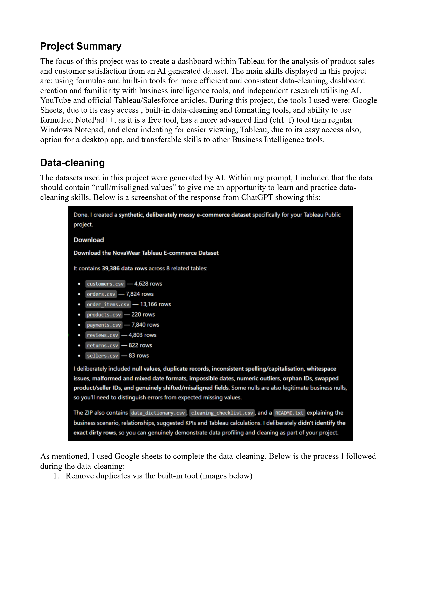
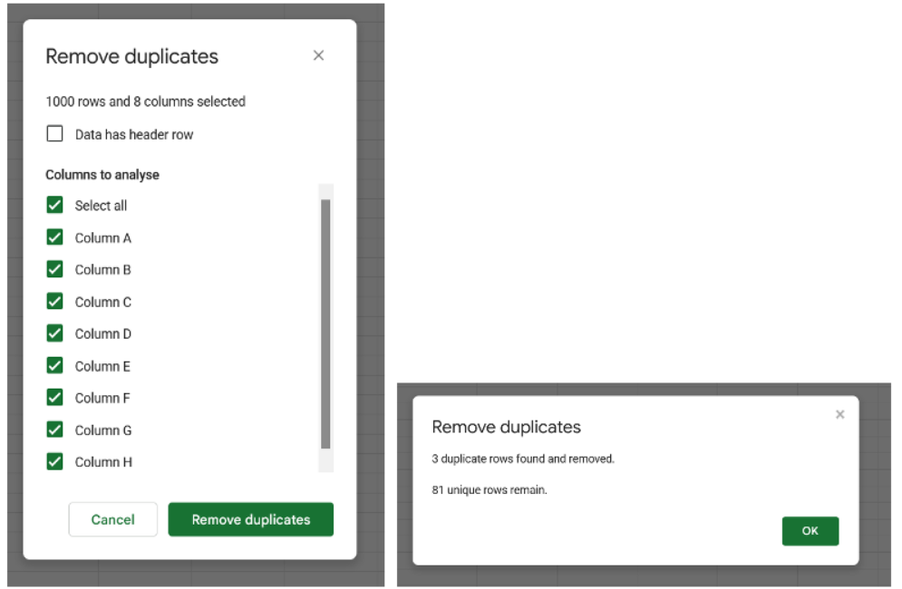
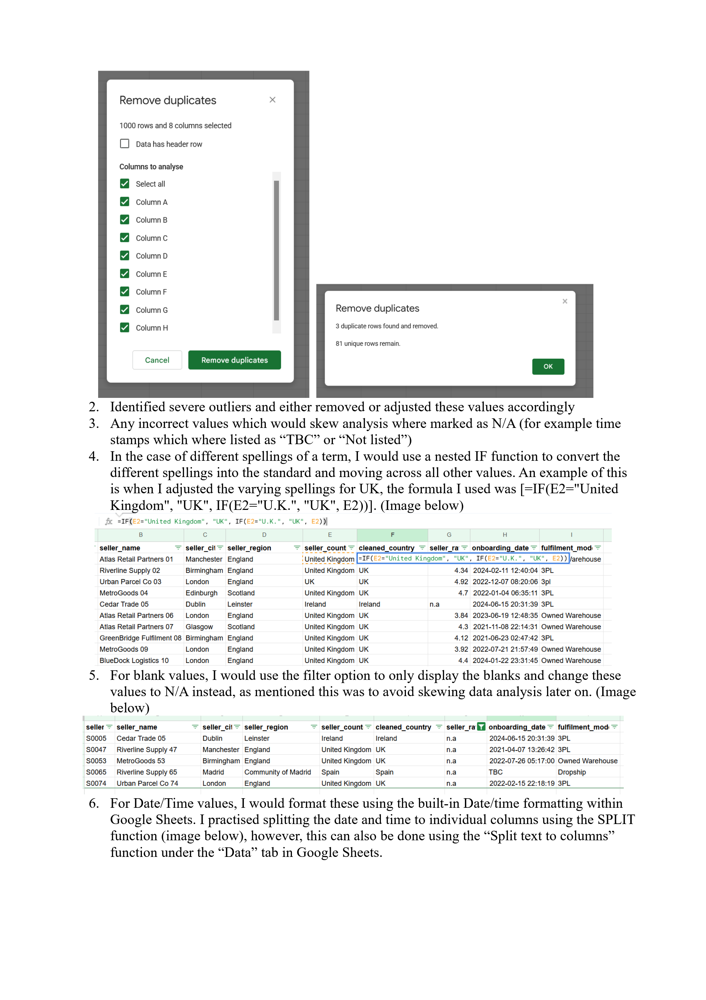
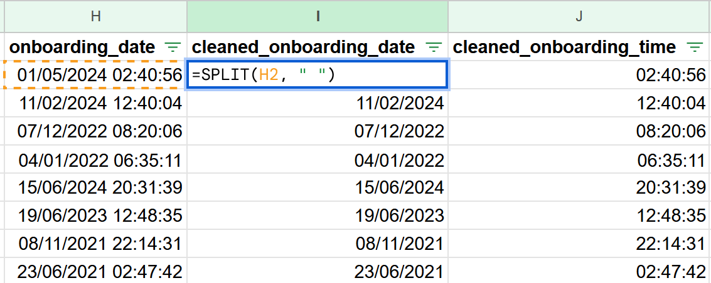
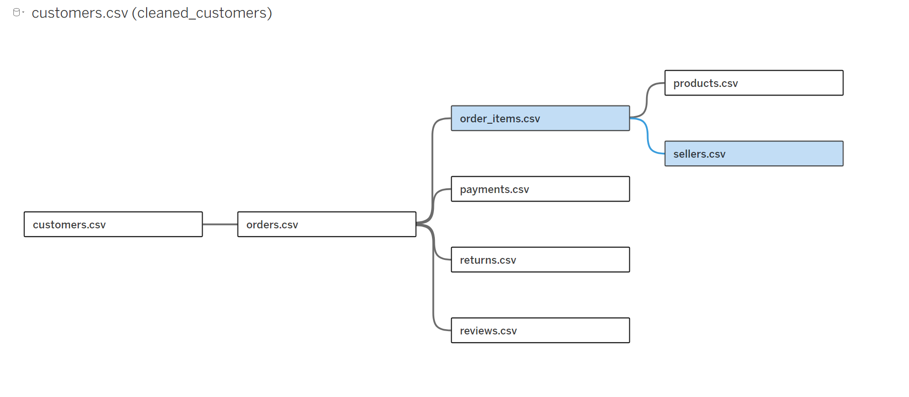
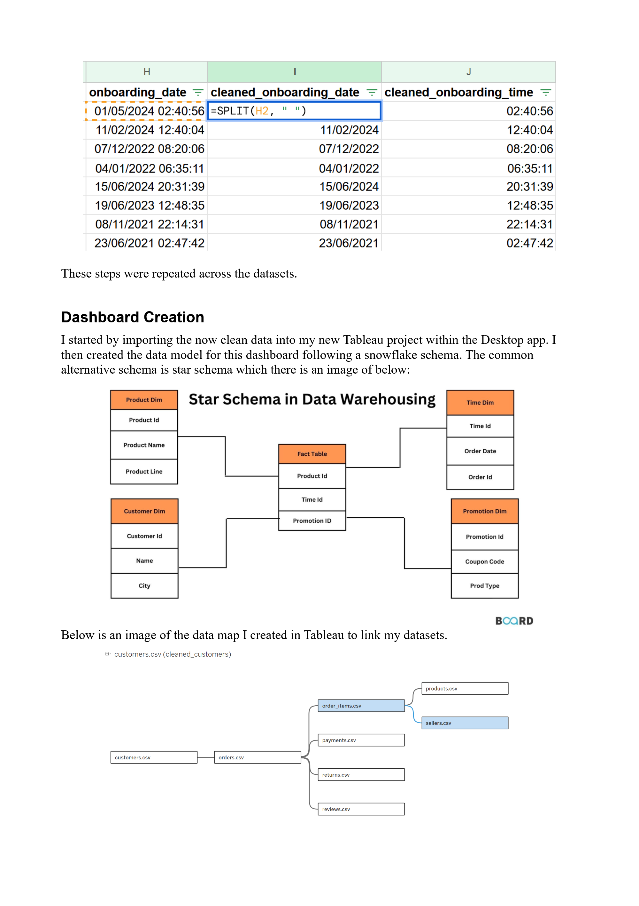
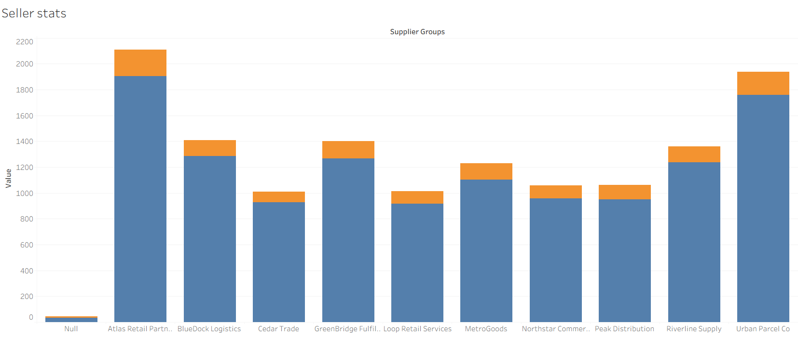
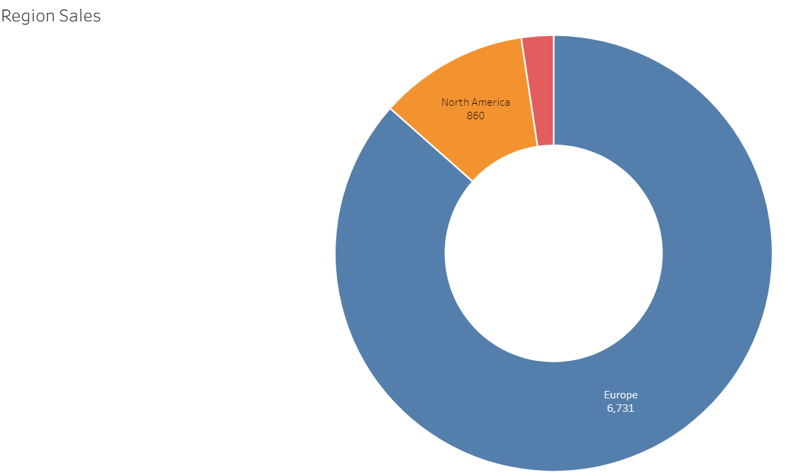
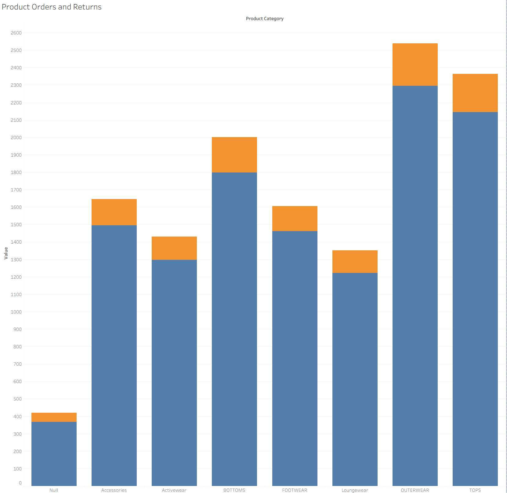
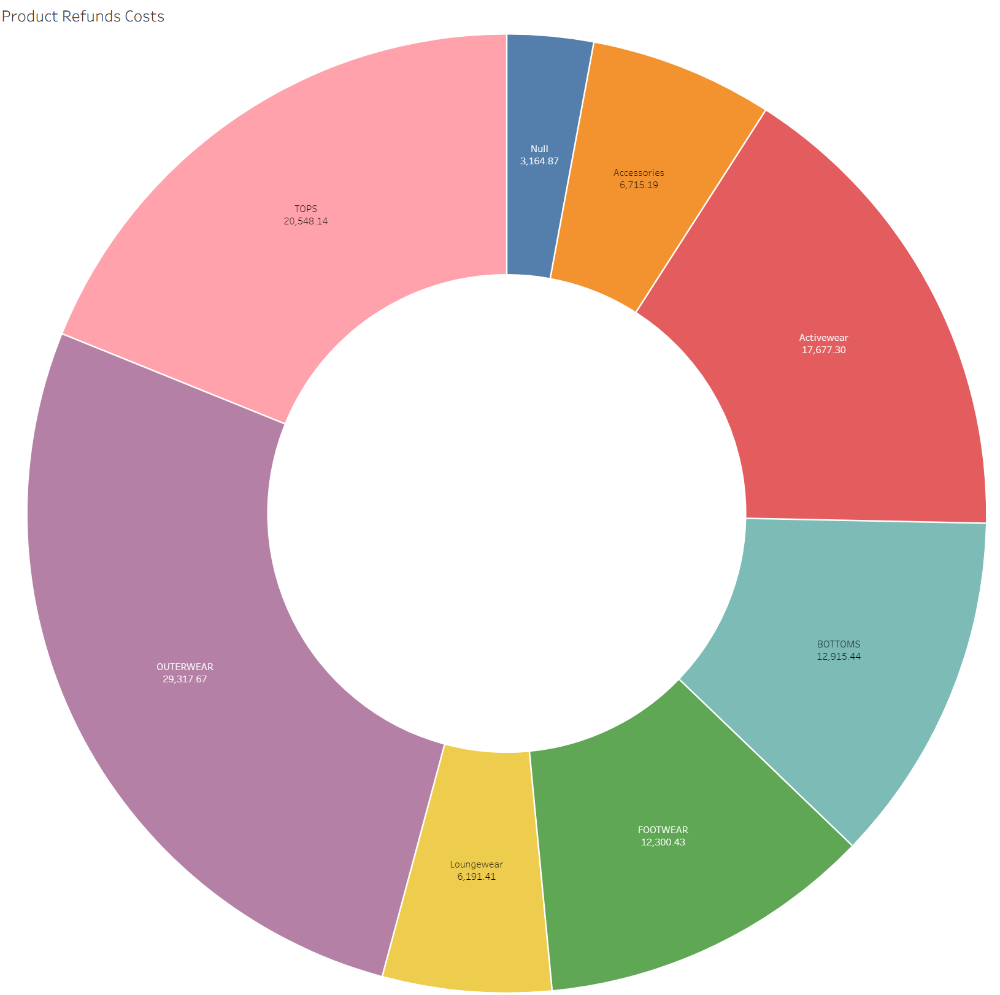

# Product Sales & Customer Satisfaction Dashboard

**Cleaning messy e-commerce data in Google Sheets and building an interactive dashboard in Tableau.**

[](https://public.tableau.com/app/profile/atal.saidy/viz/ProductSalesandCustomerSatisfaction/IntroductionPage)

**[View the live dashboard on Tableau Public](https://public.tableau.com/app/profile/atal.saidy/viz/ProductSalesandCustomerSatisfaction/IntroductionPage)**

---

## Table of Contents

1. [Project Overview](#project-overview)
2. [Tools Used](#tools-used)
3. [Dataset](#dataset)
4. [Data Cleaning](#data-cleaning)
5. [Data Model](#data-model)
6. [Dashboard Pages](#dashboard-pages)
7. [Key Observations](#key-observations)
8. [Skills Demonstrated](#skills-demonstrated)
9. [Repository Contents](#repository-contents)

---

## Project Overview

The goal of this project was to build a professional dashboard in Tableau to analyse **product sales** and **customer satisfaction** for a fictional e-commerce business, using a deliberately messy, AI-generated dataset.

The project covers the full workflow: profiling and cleaning raw data, modelling related tables, and presenting the results in a multi-page, navigable dashboard.

## Tools Used

| Tool | Why I chose it |
|------|----------------|
| **Google Sheets** | Easy access, built-in data-cleaning and formatting tools, and support for formulas |
| **Notepad++** | Free, with a more advanced find (Ctrl+F) tool and clearer indenting than Windows Notepad |
| **Tableau (Public and Desktop)** | Easy access, a desktop app option, and skills that transfer to other BI tools |

I also used AI, YouTube, and official Tableau/Salesforce documentation for independent research throughout.

## Dataset

The data was generated with ChatGPT. My prompt asked for null and misaligned values so I could practise data cleaning. The result was a synthetic e-commerce dataset (NovaWear) of roughly **39,000 rows across 8 related tables**:

| Table | Rows |
|-------|-----:|
| `customers.csv` | 4,628 |
| `orders.csv` | 7,824 |
| `order_items.csv` | 13,166 |
| `products.csv` | 220 |
| `payments.csv` | 7,840 |
| `reviews.csv` | 4,803 |
| `returns.csv` | 822 |
| `sellers.csv` | 83 |

The data was intentionally "dirty", containing null values, duplicate records, inconsistent spelling and capitalisation, whitespace issues, mixed date formats, outliers, orphan IDs, and misaligned fields. Some nulls were legitimate business nulls, so each one had to be judged rather than blindly removed.

The response from ChatGPT confirming the dataset contents:



## Data Cleaning

All cleaning was done in **Google Sheets**, following the same process on each table:

1. **Remove duplicates** using the built-in tool.

   

2. **Identify severe outliers** and either remove or adjust them.
3. **Mark incorrect values as `N/A`** where they would skew analysis (for example, timestamps listed as "TBC" or "Not listed").
4. **Standardise inconsistent spellings** using nested `IF` formulas. For example, to unify the different spellings of the UK:

   ```
   =IF(E2="United Kingdom", "UK", IF(E2="U.K.", "UK", E2))
   ```

   

5. **Replace blanks with `N/A`.** I filtered each column to show only blanks, then filled them, so missing values wouldn't skew later analysis.
6. **Format dates and times** with Google Sheets' built-in formatting, and split combined date/time values into separate columns:

   ```
   =SPLIT(H2, " ")
   ```

   (The *Data → Split text to columns* option does the same thing.)

   

## Data Model

After importing the cleaned data into Tableau Desktop, I modelled it using a **snowflake schema**. Unlike a star schema, where every dimension table connects directly to one central fact table, a snowflake schema allows dimensions to connect onward to further related tables.

Tables are linked using **relationships** (not joins) on primary/foreign keys: Customer ID, Order ID, Product ID, Seller ID, and so on.

```
customers ── orders ─┬─ order_items ─┬─ products
                     │               └─ sellers
                     ├─ payments
                     ├─ returns
                     └─ reviews
```

My data map in Tableau:



## Dashboard Pages

The dashboard has three pages, connected by navigation buttons.

### 1. Introduction
Gives background on the project and has navigation buttons to the Sales Overview and Customer Feedback Analysis pages.

### 2. Sales Overview

| Chart | Type | What it shows |
|-------|------|---------------|
| **Sales and Acquisition** | Stacked horizontal bar | Quantity of orders per product category, with each bar split by acquisition channel |
| **Seller Stats** | Stacked bar | Number of orders (blue) and returns (orange) per supplier group |
| **Region Sales** | Radial (donut) | Sales per region group |

**Sales and Acquisition**



**Seller Stats**



**Region Sales**



### 3. Customer Feedback Analysis

| Chart | Type | What it shows |
|-------|------|---------------|
| **Product Orders and Returns** | Stacked bar | Orders (blue) and returns (orange) per product group |
| **Product Refund Costs** | Radial (donut) | Total refund costs in GBP per product group |

**Product Orders and Returns**



**Product Refund Costs**



## Key Observations

- **Europe is by far the largest region for sales** (6,731), well ahead of North America (860).
- **Outerwear and Tops are the highest-volume product groups**, and Outerwear also accounts for the largest share of refund costs.
- **Returns are a small but consistent share of orders** across all product groups and supplier groups.
- **Atlas Retail Partners and Urban Parcel Co are the highest-volume supplier groups.**
- A small number of records still fall into a `Null` group, reflecting missing or legitimately null values in the source data.

## Skills Demonstrated

- **Data cleaning** in Google Sheets: deduplication, outlier handling, standardising text, handling nulls, and date/time formatting
- **Data modelling** in Tableau: snowflake schema and relationships across multiple tables
- **Dashboard design**: bar, stacked bar, and radial charts built as worksheets, then laid out in dashboards with navigation objects
- **Data manipulation in Tableau**, including creating groups within datasets
- **Independent research** using AI, YouTube, and official Tableau/Salesforce documentation

## Repository Contents

| File | Description |
|------|-------------|
| `README.md` | Project overview (this file) |
| `images/` | Screenshots used in this README (`image_01` to `image_10`) |
| `Tableau Data Analytics Project Write-up.pdf` | The original written project write-up |

---

**Author:** Atal Saidy
[Tableau Public profile](https://public.tableau.com/app/profile/atal.saidy)
